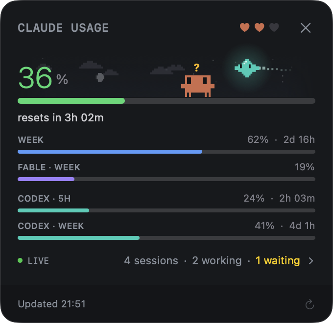
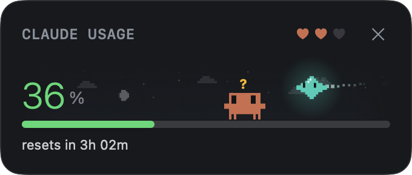

# Clawd for Mac

A macOS menu bar widget that shows your Claude Code and Codex usage limits, live sessions, and a pixel Clawd who reacts to them.

<p>
  
  
</p>

## Install

```sh
brew install --cask mkozhukh/tap/clawd
```

Requires macOS 14 or later and Claude Code installed and signed in.

## Features

- Claude Code five-hour and weekly limits in the widget and the menu bar
- Codex rate limits, when the Codex CLI is installed and signed in
- List of live Claude and Codex sessions
- Uses the existing Claude and Codex logins; doesn't read or store credentials
- Doesn't run models or spend usage

## Build from source

Requires Apple's Command Line Tools (`xcode-select --install`) with Swift 6 or newer. Full Xcode isn't needed.

```sh
./scripts/build-app.sh
open dist/Clawd.app
```

Set `CODE_SIGN_IDENTITY` to sign with your own identity; otherwise the build is ad-hoc signed.

Development:

```sh
swift build
swift run ClawdChecks
```

- `Sources/ClawdCore` — usage parsers, data models, mood rules
- `Sources/ClawdUsage` — AppKit app, SwiftUI views, polling, persistence
- `Tests/ClawdCoreTests` — parser, date and storage checks

## License

MIT © 2026 Maksim Kozhukh, see `LICENSE`.

Based on [clawd-usage-winwidget](https://github.com/Enhed/clawd-usage-winwidget) by Venger Sergey (MIT). The Clawd sprite, mascot behavior, and sky and weather rules are ported from it; see `THIRD_PARTY_NOTICES`.

Not affiliated with Anthropic. Clawd and Claude belong to Anthropic.
